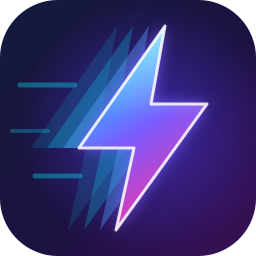

<div align="center">



# Nitro

**Frame generation for any DirectX 11 / 12 game: 2x, 3x or 4x, injected straight into the game.**

Powered by the frame-generation algorithm from your own copy of [Lossless Scaling](https://store.steampowered.com/app/993090/Lossless_Scaling/).

[](https://github.com/RJ22256/Nitro/actions/workflows/build.yml)
[](https://github.com/RJ22256/Nitro/releases)


[**Download**](https://github.com/RJ22256/Nitro/releases/latest) · [How to use](#-how-to-use) · [Troubleshooting](#-troubleshooting) · [Building](#-building)

</div>

---

## ✨ Features

- **2x / 3x / 4x frame generation** in any 64-bit DX11 or DX12 game
- **Runs inside the game**: no window capture, no borderless-window requirement, no overlay app running alongside
- **Two ways to load it:** install it once into the game folder (works with Steam launches), or launch the game with Nitro injected
- **Live hotkeys:** <kbd>End</kbd> toggles frame gen, <kbd>Home</kbd> cycles 2x → 3x → 4x
- **Quality & performance modes**, adjustable flow scale, HDR support
- **Leaves the game's rendering state untouched:** D3D11 work uses its own context state, and D3D12 games go through D3D11On12 on the game's own queue
- **Removes cleanly**, and backs up any existing `dxgi.dll` (e.g. ReShade), then restores it

> [!IMPORTANT]
> Nitro ships **none** of Lossless Scaling's code or shaders. It reads them at runtime from the `Lossless.dll` in **your** Lossless Scaling install, so you need to own Lossless Scaling on Steam.

> [!WARNING]
> **Single-player games only.** Injecting into games with anti-cheat can get you banned.

## 🚀 How to use

1. Download **`Nitro-x64.zip`** from [Releases](https://github.com/RJ22256/Nitro/releases) and unzip it.
2. Copy **`Lossless.dll`** from `Steam\steamapps\common\Lossless Scaling\` into the Nitro folder.
3. Run **`Nitro.exe`** and **Browse...** to the game's `.exe`.
   For Unreal Engine games, pick `...\Binaries\Win64\*-Shipping.exe` (Nitro suggests it if it finds one).
4. Choose a **multiplier** and, if you like, a **flow scale** (100% at 1080p, 50–75% at 1440p/4K).
5. Then either:
   - **Install into game folder** (recommended), then start the game the normal way; or
   - **Launch with injection**, which leaves nothing in the game folder.

### Tips for smooth results

| Tip | Why |
|---|---|
| Keep **"Pace generated frames with VSync"** on | Each frame gets its own refresh, so a 240 Hz screen at 4x shows 60 real + 180 generated frames |
| Cap the game at **refresh rate ÷ multiplier** | Gives even frame pacing (e.g. 60 FPS on 240 Hz for 4x) |
| Have **≥ 40–60 real FPS** before generating frames | Like any frame generation, it adds about one frame of latency and needs good input frames |

## ⚙️ Settings

Nitro writes `Nitro.ini` next to the hook. That's the game folder for an install, or the Nitro folder for launch mode.

```ini
[Nitro]
LosslessDll=C:\...\Lossless.dll
Multiplier=2          ; 2-4
FlowScale=1.00        ; 0.25-1.00
PerformanceMode=0
HDR=-1                ; -1 auto, 0 off, 1 on
VSyncPacing=1
EnabledAtStart=1
ToggleKey=0x23        ; virtual-key code (End)
CycleKey=0x24         ; (Home)
ShaderOffset=-1       ; -1 auto-detect
ProbeD3D12=1          ; set 0 if a DX12 game won't start with Nitro
```

## 🛠 Troubleshooting

Check **`Nitro.log`** first. It's written next to the hook and records whether the shaders loaded, which graphics API was detected, and the resolution and format.

| Problem | Try |
|---|---|
| Game won't start after installing | **Remove from game folder**, then use **Launch with injection**. For DX12 games, try `ProbeD3D12=0`. |
| Log says *Shader load failed* | Update Lossless Scaling and copy a fresh `Lossless.dll`. |
| Log says *Unsupported back buffer* | The game uses an unusual swap-chain format or an MSAA back buffer. |
| No log file at all | The hook never loaded. Usual causes: wrong exe (Unreal stub), a Vulkan/OpenGL game, or anti-cheat. |
| *Access denied* when installing | The game is in a protected folder, so run Nitro as administrator. |

Still stuck? [Open an issue](https://github.com/RJ22256/Nitro/issues) and attach `Nitro.log`.

## 🔬 How it works

```
 game renders frame N ──► Present() ──► Nitro hook
                                          │
                     copy frame N out of the back buffer
                                          │
       LSFG 3.1 compute pipeline (Lossless Scaling's DXBC shaders):
       mip pyramid → feature extraction → 7-level motion estimation
                 → refinement → synthesis of 1-3 in-between frames
                                          │
        present generated frames ──► restore + present real frame N
```

- **Hooking:** Nitro creates throwaway D3D11/D3D12 swap chains to find DXGI's vtable, then redirects `Present`, `Present1`, `ResizeBuffers` and `ResizeBuffers1`.
- **D3D11 games:** everything runs on the game's own device, inside a separate `ID3DDeviceContextState`.
- **D3D12 games:** a D3D11On12 device is created on the game's own command queue, with the back buffers wrapped.
- **Shaders:** Lossless Scaling's own Shader Model 5 compute shaders, loaded from `Lossless.dll` and run natively, with no translation layer.
- **Pipeline:** the pass layout follows [lsfg-vk](https://github.com/PancakeTAS/lsfg-vk) v1 (MIT); see [THIRD_PARTY_NOTICES.md](THIRD_PARTY_NOTICES.md).

## 🧱 Building

Requires **Visual Studio 2022** ("Desktop development with C++") and **CMake**.

```bat
build.bat
```

The output is `build\dist\Nitro.exe` and `build\dist\NitroHook.dll`. Every push is also built by GitHub Actions, and pushing a `v*` tag publishes a release with `Nitro-x64.zip` attached.

## 📋 Limitations

- 64-bit **DX11 / DX12** only. No Vulkan, OpenGL, DX9/10 or 32-bit games.
- No in-game overlay; settings live in the app and the hotkeys.
- MSAA back buffers aren't supported (rare in modern games).

## Credits

- Frame-generation algorithm and shaders: **Lossless Scaling** by THS. Nitro is not affiliated with or endorsed by its developer.
- Pipeline reference: **lsfg-vk** by PancakeTAS (MIT).
