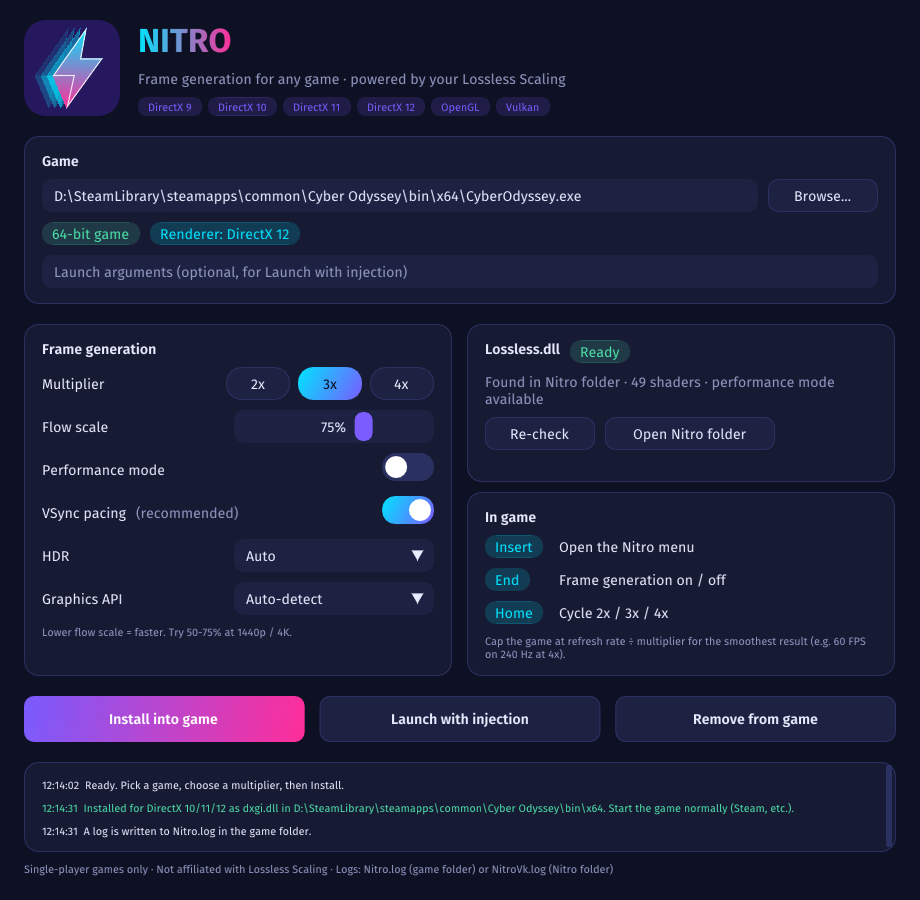
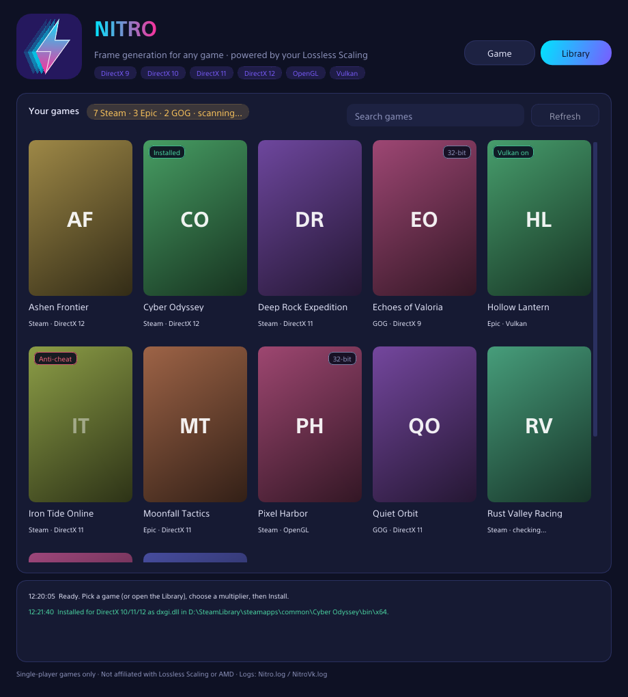
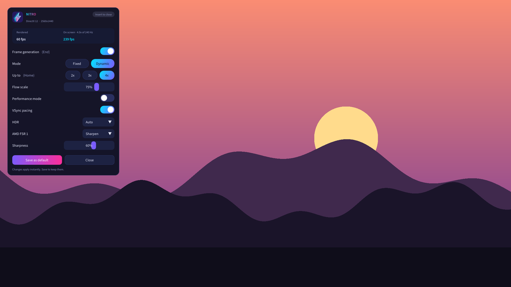
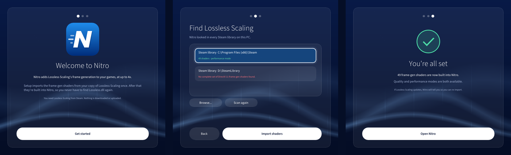

<div align="center">


# Nitro

**Frame generation for any DirectX 9 / 10 / 11 / 12, OpenGL or Vulkan game: 2x, 3x or 4x, injected straight into the game.**

Powered by the frame-generation algorithm from your own copy of [Lossless Scaling](https://store.steampowered.com/app/993090/Lossless_Scaling/).

[](https://github.com/RJ22256/Nitro/actions/workflows/build.yml)
[](https://github.com/RJ22256/Nitro/releases)


[**Download**](https://github.com/RJ22256/Nitro/releases/latest) · [How to use](#-how-to-use) · [Troubleshooting](#-troubleshooting) · [Building](#-building)

</div>

---

<p align="center">
  
  
  
</p>

## ✨ Features

- **Fixed 2x / 3x / 4x or Dynamic mode**, which automatically generates just enough frames to reach your monitor's refresh rate
- Frame generation in **DirectX 9, 10, 11, 12, OpenGL and Vulkan** games, **64-bit and 32-bit**
- **Game Library:** finds your Steam, Epic Games and GOG Galaxy games, with cover art, the detected API and whether Nitro is installed. One click to install or remove. Games that ship anti-cheat are flagged and blocked.
- **AMD FSR 1:** RCAS sharpening in every API, plus EASU upscaling in DirectX 11/12 games
- **Detects the game's graphics API automatically**, or you can pick it yourself
- **Runs inside the game**: no window capture, no borderless-window requirement, no overlay app running alongside
- **Two ways to load it:** install it once (works with Steam launches), or launch the game with Nitro injected
- **In-game menu** (<kbd>Insert</kbd>): change frame gen, the multiplier, flow scale, performance mode, VSync pacing, HDR and FSR live, see rendered and on-screen FPS, and save the settings as your default
- **Live hotkeys:** <kbd>End</kbd> toggles frame gen, <kbd>Home</kbd> cycles 2x → 3x → 4x
- **Quality & performance modes**, adjustable flow scale, HDR support
- **Leaves the game's rendering state untouched:** each API gets its own path (see [How it works](#-how-it-works))
- **Removes cleanly**, and backs up any DLL it replaces (e.g. ReShade's `dxgi.dll`), then restores it

> [!IMPORTANT]
> Nitro ships **none** of Lossless Scaling's code or shaders. Setup imports them on your own PC from **your** Lossless Scaling install, so you need to own Lossless Scaling on Steam. `Nitro.shaders` holds Lossless Scaling's work, so don't share it or upload it anywhere.

> [!WARNING]
> **Single-player games only.** Injecting into games with anti-cheat can get you banned.

## 🚀 How to use

1. Download **`Nitro-Setup.exe`** from [Releases](https://github.com/RJ22256/Nitro/releases) and run it. It installs for your user only (no admin prompt) and adds Start menu and optional desktop shortcuts. Prefer a portable copy? Download **`Nitro-x64.zip`** instead and unzip it anywhere you can write to.
2. Run **Nitro**. The first time, a short **setup** finds Lossless Scaling in your Steam libraries (or you can browse to it) and imports its frame-gen shaders. After that they're built into Nitro (`Nitro.shaders`, next to `Nitro.exe`), so you never have to find `Lossless.dll` again.
3. Open the **Library** and click your game, or **Browse...** to the game's `.exe` on the **Game** tab.
   For Unreal Engine games, pick `...\Binaries\Win64\*-Shipping.exe` (Nitro suggests it if it finds one; the Library picks it for you).
4. Choose a **mode**:
   - **Fixed**: always 2x, 3x or 4x.
   - **Dynamic**: Nitro measures each real frame and generates only as many frames as it takes to fill your monitor's refresh rate, up to the multiplier you pick. For example, 60 FPS on a 144 Hz screen averages 2.4x by alternating 2x and 3x. If the game already reaches your refresh rate, nothing is generated.

   Then pick a **flow scale** if you like (100% at 1080p, 50–75% at 1440p/4K).
5. Leave **Graphics API** on *Auto-detect* unless the game has several renderers (e.g. a DX12/Vulkan toggle). In that case, pick the one you play with.
6. Then either:
   - **Install into game** (recommended), then start the game the normal way; or
   - **Launch with injection**, which leaves nothing behind.

<p align="center"></p>

### Game Library

The **Library** tab lists the games installed through Steam, Epic Games and GOG Galaxy. Nitro reads the stores' own install records, so nothing is uploaded and no accounts are involved. Steam games show their cover art from Steam's local cache. Each tile shows the store and detected graphics API, plus badges for **Installed** / **Vulkan on**, **32-bit** and **Anti-cheat**. Hover a game to **Install** or **Remove** it with your current settings, or click it to open it on the Game tab. Games from other launchers still work through **Browse...**.

Nitro guesses each game's main `.exe` (preferring Unreal `*-Shipping.exe` files and skipping launchers, crash reporters and installers). If it picks the wrong one, choose the right exe with **Browse...**.

### AMD FSR 1

| Setting | What it does | Where |
|---|---|---|
| **Sharpen** | AMD's RCAS contrast-adaptive sharpening on every real and generated frame | All APIs |
| **Upscale** | EASU upscaling + RCAS. The game renders at a lower resolution and FSR scales it to the window | DirectX 11 / 12 |

For **Upscale**, run the game **borderless or windowed** and set its resolution lower than your screen (e.g. 1706×960 on a 2560×1440 display for FSR "Quality"). Nitro tells the game its back buffer is the size it asked for, keeps the real one at the window's size, and runs FSR before frame generation, so generated frames are full-resolution. Switching Upscale on or off takes effect the next time the game starts; Sharpen and the sharpness slider work live.

> [!NOTE]
> **Why not FSR 3?** FSR 3 (upscaling and frame generation) needs the game's motion vectors, depth buffer and an unjittered camera. Only the engine has those, so FSR 3 can't be bolted onto an arbitrary game the way FSR 1 and Lossless Scaling's frame gen can. For games that already support DLSS, FSR 2 or XeSS, [OptiScaler](https://github.com/optiscaler/OptiScaler) can swap in FSR 3; Nitro's frame gen works alongside it.

### 32-bit games

Nitro detects 32-bit games and uses `NitroHook32.dll` / `NitroVk32.dll` for them automatically. **Launch with injection** goes through the small `NitroInject32.exe` helper, because a 64-bit program can't load a DLL into a 32-bit process directly. Keep all the files from the zip together.

When Lossless Scaling updates, Nitro shows **Update available** on the shaders card. Click **Re-import** to pick up the new version.

What **Install** does for each API:

| API | What Install does |
|---|---|
| DirectX 10 / 11 / 12 | Copies the hook into the game folder as `dxgi.dll` |
| DirectX 9 | Copies the hook into the game folder as `d3d9.dll` |
| OpenGL | Copies the hook in as `version.dll` (or `dxgi.dll`) if the game loads one; otherwise use **Launch with injection** |
| Vulkan | Registers Nitro's Vulkan layer and switches it on **for that exe only**. Nothing is copied into the game folder. |

### In game

| Key | Does |
|---|---|
| <kbd>Insert</kbd> | Opens the Nitro menu. While it's open, the game doesn't receive your mouse and keyboard input. |
| <kbd>End</kbd> | Turns frame generation on/off |
| <kbd>Home</kbd> | Cycles 2x → 3x → 4x |

The menu is drawn *after* frame generation, so it never gets smeared into the generated frames. **Save as default** writes your changes to `Nitro.ini`.

### Tips for smooth results

| Tip | Why |
|---|---|
| Try **Dynamic** mode first | No FPS cap needed. It aims just under your refresh rate so the game is never held back. |
| Keep **"Pace generated frames with VSync"** on | Each frame gets its own refresh, so a 240 Hz screen at 4x shows 60 real + 180 generated frames |
| In **Fixed** mode, cap the game at **refresh rate ÷ multiplier** | Gives even frame pacing (e.g. 60 FPS on 240 Hz for 4x) |
| Have **≥ 40–60 real FPS** before generating frames | Like any frame generation, it adds about one frame of latency and needs good input frames |

## ⚙️ Settings

Nitro writes `Nitro.ini` next to the hook. That's the game folder for an install, or the Nitro folder for launch mode.

```ini
[Nitro]
Shaders=C:\...\Nitro\Nitro.shaders   ; imported by setup
LosslessDll=C:\...\Lossless.dll       ; used only if there's no Nitro.shaders
Multiplier=2          ; 2-4
FlowScale=1.00        ; 0.25-1.00
PerformanceMode=0
Dynamic=0             ; 1 = top up to the refresh rate (Multiplier becomes the maximum)
HDR=-1                ; -1 auto, 0 off, 1 on
FSR=0                 ; 0 off, 1 sharpen, 2 upscale (DX11/12)
FSRSharpness=0.60     ; 0-1
VSyncPacing=1
EnabledAtStart=1
ToggleKey=0x23        ; virtual-key code (End)
CycleKey=0x24         ; (Home)
MenuKey=0x2D          ; (Insert) opens the in-game menu
ShaderOffset=-1       ; -1 auto-detect
ProbeD3D12=1          ; set 0 if a DX12 game won't start with Nitro
Api=auto              ; dxgi, d3d9, opengl, all (written by Install)
```

Vulkan games are listed under `[VulkanGames]` in the `Nitro.ini` next to `Nitro.exe`. Their settings come from that file too.

## 🛠 Troubleshooting

Check **`Nitro.log`** first. It's written next to the hook and records whether the shaders loaded, which graphics API was detected, and the resolution and format.

| Problem | Try |
|---|---|
| Game won't start after installing | **Remove from game folder**, then use **Launch with injection**. For DX12 games, try `ProbeD3D12=0`. |
| Log says *Shader load failed* | Open Nitro and click **Re-import** (or update Lossless Scaling first), then **Install** again. |
| Log says *Unsupported back buffer* | The game uses an unusual swap-chain format or an MSAA back buffer. |
| Vulkan game: nothing happens | Check `NitroVk.log` in the Nitro folder. If there isn't one, the game isn't enabled (run **Install** again) or another Vulkan layer is in the way. |
| OpenGL game: log says *WGL_NV_DX_interop2 not supported* | The GPU driver can't share textures between OpenGL and D3D11. Update your driver. |
| DX9 game: generated frames flash or tear | The game presents without VSync. Turn VSync on in the game. |
| No log file at all | The hook never loaded. Usual causes: wrong exe (Unreal stub), a Vulkan/OpenGL game, or anti-cheat. |
| FSR Upscale does nothing | It needs a DirectX 11/12 game running borderless/windowed at a lower resolution than the window, and a game restart after switching it on. The log says *FSR 1: game renders WxH, upscaling to WxH* when it's active. |
| Library is missing a game | Only Steam, Epic Games and GOG Galaxy installs are listed. Use **Browse...** for others. |
| Uninstalling Nitro | Use **Remove from game** for each game first, then uninstall from Windows Settings → Apps. The uninstaller removes Nitro's settings, imported shaders and Vulkan layer registration, but doesn't touch game folders. |
| *Access denied* when installing | The game is in a protected folder, so run Nitro as administrator. |

Still stuck? [Open an issue](https://github.com/RJ22256/Nitro/issues) and attach `Nitro.log`.

## 🔬 How it works

```
 game renders frame N ──► Present() ──► Nitro hook
                                          │
                     copy frame N out of the back buffer
                                          │
       LSFG 3.1 compute pipeline (Lossless Scaling's DXBC shaders):
       mip pyramid → feature extraction → 7-level motion estimation
                 → refinement → synthesis of 1-3 in-between frames
                                          │
        present generated frames ──► restore + present real frame N
```

| API | Hook | How frames move |
|---|---|---|
| **DX11** | DXGI `Present` / `ResizeBuffers` | Runs on the game's own device, inside a separate `ID3DDeviceContextState` |
| **DX12** | DXGI `Present` / `ResizeBuffers` | D3D11On12 on the game's own command queue, with the back buffers wrapped |
| **DX10** | DXGI `Present` | Shared textures with Nitro's own D3D11 device |
| **DX9 / 9Ex** | `IDirect3DDevice9::Present` / `PresentEx` / `Reset` (MinHook) | Through system memory to Nitro's D3D11 device (DX9 can't share GPU textures) |
| **OpenGL** | `SwapBuffers` / `wglSwapBuffers` (MinHook) | `WGL_NV_DX_interop2` texture sharing with Nitro's D3D11 device |
| **Vulkan** | Implicit Vulkan layer (`NitroVk.dll`), active only for enabled games | D3D11 textures imported with `VK_KHR_external_memory_win32`; extra `vkAcquireNextImageKHR` + `vkQueuePresentKHR` per generated frame |

- **Shaders:** Lossless Scaling's own Shader Model 5 compute shaders, imported once from `Lossless.dll` into `Nitro.shaders` and run natively, with no translation layer.
- **FSR 1:** AMD's official FidelityFX FSR 1.0.2 shader (EASU + RCAS), compiled at run time with `D3DCompile` and run as compute passes on the same D3D11 device.
- **Pipeline:** the pass layout follows [lsfg-vk](https://github.com/PancakeTAS/lsfg-vk) v1 (MIT); see [THIRD_PARTY_NOTICES.md](THIRD_PARTY_NOTICES.md).

## 🧱 Building

Requires **Visual Studio 2022** ("Desktop development with C++") and **CMake**.

```bat
build.bat
```

`build.bat` builds both the 64-bit and the 32-bit parts, and `package\Nitro-Setup.exe` too if [Inno Setup 6](https://jrsoftware.org/isinfo.php) is installed. The output is in `build\dist`: `Nitro.exe`, `NitroHook.dll`, `NitroVk.dll`, `NitroVk.json`, plus `NitroHook32.dll`, `NitroVk32.dll`, `NitroVk32.json`, `NitroInject32.exe` and the `Fonts` folder. CMake downloads MinHook, the Vulkan headers, Dear ImGui and AMD FidelityFX FSR automatically. Every push is also built by GitHub Actions, and pushing a `v*` tag publishes a release with `Nitro-Setup.exe` and `Nitro-x64.zip` attached.

## 📋 Limitations

- FSR 1 upscaling is DirectX 11/12 only (other APIs get sharpening). FSR 3 isn't possible without engine integration (see above).
- The Library only reads Steam, Epic Games and GOG Galaxy installs.
- DX9 frames make a round trip through system memory. That's fine at 1080p but costs more at 4K.
- OpenGL needs a driver with `WGL_NV_DX_interop2` (current NVIDIA, AMD and Intel drivers have it), and Vulkan needs `VK_KHR_external_memory_win32`.
- The in-game menu can only block mouse and keyboard input that the game reads through normal window messages or raw input. Games that read DirectInput directly may still react while it's open.
- MSAA back buffers aren't supported (rare in modern games).

## Credits

- Frame-generation algorithm and shaders: **Lossless Scaling** by THS. Nitro is not affiliated with or endorsed by its developer.
- Pipeline reference: **lsfg-vk** by PancakeTAS (MIT).
- UI: **Dear ImGui** by Omar Cornut (MIT), set in **Source Sans 3** by Adobe (SIL Open Font License 1.1). Function hooking: **MinHook** by Tsuda Kageyu (BSD 2-Clause). Vulkan headers by **Khronos** (Apache 2.0).
- Upscaling and sharpening: **AMD FidelityFX Super Resolution 1** (MIT). AMD and FidelityFX are trademarks of Advanced Micro Devices, Inc.; Nitro is not affiliated with AMD.
